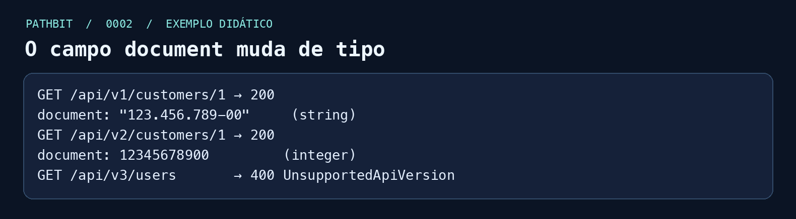
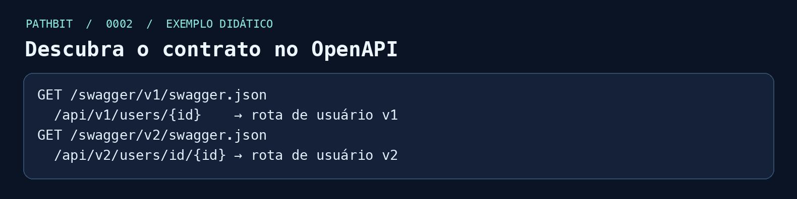

# Versionamento de API no ASP.NET Core com dois contratos em execução

Uma alteração de API pode compilar, passar pelos testes do serviço e ainda quebrar o aplicativo de quem a consome. Imagine um cliente que chama `/api/v1/users/1` e um modelo que lê um documento como texto. A próxima versão quer usar `/api/v2/users/id/1` e devolver um número para o documento. O servidor consegue implementar as duas mudanças de uma vez. Os consumidores precisam de tempo para se adaptar.

Neste laboratório .NET, as duas versões atendem no mesmo processo. Cada requisição escolhe a versão pelo caminho e recebe os cabeçalhos de depreciação. O Swagger ajuda a inspecionar o contrato que cada cliente recebe. O exercício usa dados ilustrativos e muda o tipo de `document` de propósito para tornar a quebra visível.

## Veja as duas versões no terminal

Na pasta `0002_versionamento_api`, suba a API com o SDK .NET 10.

```bash
dotnet run --project src/Api --launch-profile http
```

Esse perfil local usa a porta 7000 e o ambiente `Development`. Em outro terminal, faça as três consultas.

```bash
curl -i -w '\n' http://localhost:7000/api/v1/customers/1
curl -i -w '\n' http://localhost:7000/api/v2/customers/1
curl -i -w '\n' http://localhost:7000/api/v3/users
```

As duas primeiras devolvem `200 OK`. Na v1, as aspas em `"123.456.789-00"` indicam uma string no JSON. Na v2, `12345678900` vem como número. O cliente que espera uma string precisa tratar o novo formato quando migrar. Em aplicações reais, preserve identificadores com zeros à esquerda em formato textual.

A terceira consulta devolve `400` com `UnsupportedApiVersion` nesta biblioteca. Os cabeçalhos `api-supported-versions: 2.0` e `api-deprecated-versions: 1.0` permitem detectar o estado das versões em uma resposta bem-sucedida. A captura foi feita com a mesma API em uma porta alternativa, usando a saída de status, cabeçalhos e campos do JSON.



Consulte também as rotas de usuários para ver o impacto no caminho.

| Versão | Consulta a um usuário | Tipo de documento na consulta a clientes |
| --- | --- | --- |
| v1, deprecada | `GET /api/v1/users/1` | `string` |
| v2 | `GET /api/v2/users/id/1` | `integer` no OpenAPI |

A lista continua em `/api/v1/users` e `/api/v2/users`. Na busca por ID, insira o segmento `id` ao usar a v2. Se a chamada chega à ação da v2 com um usuário inexistente, o próprio controller devolve `404`. Um erro de seleção de rota ou versão acontece em outra etapa da requisição.

## Siga a requisição no código

O [Program.cs](../src/Api/Program.cs) registra a versão padrão, os cabeçalhos informativos e a descoberta de contratos. No código deste laboratório, o segmento obrigatório `v{version:apiVersion}` continua precisando estar na URL. O valor padrão da biblioteca por si só não cria uma rota sem esse segmento.

```csharp
builder.Services.AddApiVersioning(options =>
{
    options.AssumeDefaultVersionWhenUnspecified = true;
    options.DefaultApiVersion = new ApiVersion(1, 0);
    options.ReportApiVersions = true;
});
```

O [UserController](../src/Api/Controllers/UserController.cs) declara as versões no controller. Este recorte mostra os atributos das duas ações que leem o mesmo usuário.

```csharp
// O caminho antigo continua associado à ação da v1.
[HttpGet("v{version:apiVersion}/users/{id}")]
[MapToApiVersion("1.0")]
[Obsolete("This API version is deprecated. Please use version 2.0.")]

// Na ação da v2, a URL ganhou o segmento /id/.
[HttpGet("v{version:apiVersion}/users/id/{id}")]
[MapToApiVersion("2.0")]
```

A declaração `[ApiVersion("1.0", Deprecated = true)]` marca a versão como deprecada na biblioteca. O atributo `[Obsolete]` na ação assinala seu estado no código. A presença de ambos ajuda o mantenedor a acompanhar a transição e preserva a rota ativa para consumidores da v1.

No [CustomerController](../src/Api/Controllers/CustomerController.cs), o caminho de clientes mantém o mesmo formato nas duas versões. O seletor de versão determina qual ação executa e qual modelo é serializado. O retorno da v1 é `ActionResult<CustomerModel>`, e o da v2, `ActionResult<CustomerModelV2>`. O atributo `ProducesResponseType` aponta para o tipo público correspondente e alimenta a descrição OpenAPI.

## Confira o contrato que vai para o consumidor

Abra o Swagger em `http://localhost:7000/swagger` e mude a seleção de V1 para V2. A interface usa os documentos `/swagger/v1/swagger.json` e `/swagger/v2/swagger.json`. Você pode baixá-los diretamente com `curl` e comparar os caminhos e tipos que uma ferramenta de geração de clientes usaria.

```bash
curl -sS http://localhost:7000/swagger/v1/swagger.json
curl -sS http://localhost:7000/swagger/v2/swagger.json
```

`AddVersionedApiExplorer` usa `GroupNameFormat` para formar os nomes `v1` e `v2`. Com `SubstituteApiVersionInUrl`, a URL documentada recebe o número no lugar do parâmetro. `ConfigureSwaggerOptions` percorre as descrições e registra um documento para cada grupo. Este ponto conecta os atributos aplicados aos controllers ao contrato que aparece no Swagger.



Na raiz do repositório, execute `dotnet test tests/ApiVersioning.Tests` para verificar os comportamentos de contrato. O exemplo usa a biblioteca original `Microsoft.AspNetCore.Mvc.Versioning` 5.1. Ao iniciar uma nova aplicação, consulte o projeto `Asp.Versioning.Mvc` e confirme as alterações de registro. [Guia de migração da biblioteca](https://github.com/dotnet/aspnet-api-versioning/wiki/Migration).

A convivência entre versões serve para migrar em etapas. Avise quais caminhos e tipos foram alterados, entregue a descrição da v2 para os consumidores e combine uma janela de transição. Acompanhe o uso da rota antiga antes de removê-la. Ao testar a migração, inclua pelo menos uma chamada com o cliente legado e outra com o cliente gerado a partir do novo Swagger. Isso ajuda a perceber que duas versões válidas no servidor ainda exigem dois contratos bem definidos para quem chama.

[Laboratório executável e tabela de rotas](https://github.com/pathbit/pathbit-academy-dotnet/tree/master/0002_versionamento_api).

Developed with ❤️ by [Pathbit](https://www.pathbit.com.br/)
