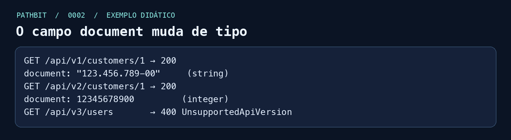

# Uma rota nova pode quebrar um cliente antigo

Uma equipe troca a busca de usuários de `/users/{id}` para `/users/id/{id}`. Ao mesmo tempo, o documento de cliente que vinha como string passa a sair como número. A mudança compila, mas quem usa o caminho antigo ou desserializa o formato anterior precisa migrar em outro ritmo.

No laboratório de **versionamento de APIs do Pathbit Academy .NET**, as duas versões rodam no mesmo processo. Na pasta do exercício, suba a API com `dotnet run --project src/Api --launch-profile http`. Em outro terminal, compare estas duas chamadas.

```bash
curl -i http://localhost:7000/api/v1/customers/1
curl -i http://localhost:7000/api/v2/customers/1
```

Os dois contratos devolvem `200`. O corpo da v1 tem `"123.456.789-00"`. O da v2 tem `12345678900`. O cabeçalho `api-deprecated-versions: 1.0` informa que a v1 está deprecada e a rota permanece acessível durante a transição. O Swagger tem um documento por versão, com o caminho e o tipo que cada cliente deve usar.

O exemplo também consulta a v3 para mostrar como o serviço responde quando o cliente pede uma versão que ele ainda não oferece.



O exercício ajuda a praticar uma migração completa. Leia primeiro os dois contratos. Teste o cliente antigo e o cliente novo. Combine a janela de migração e acompanhe quem ainda chama a rota que será removida.

[Código, comandos, Swagger e testes](https://github.com/pathbit/pathbit-academy-dotnet/tree/master/0002_versionamento_api).

#DotNet #ASPNETCore #APIs #PathbitAcademy
