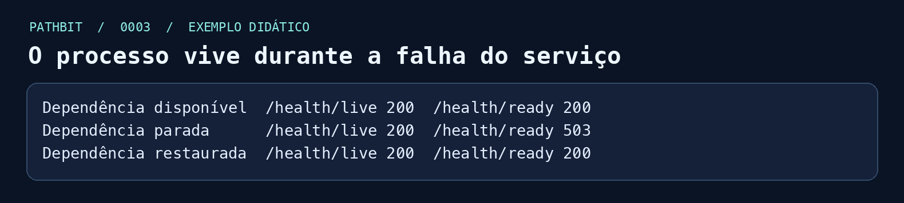
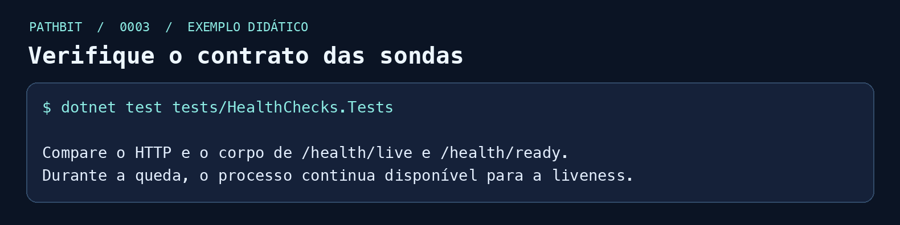

# Duas rotas de saúde para uma API que depende do estoque

O estoque ficou fora do ar e, poucos minutos depois, as réplicas da API de pedidos começaram a reiniciar. A lógica da sonda consultava o mesmo serviço externo a cada tentativa. A indisponibilidade continuava enquanto os servidores que poderiam esperar pela recuperação eram reiniciados.

Neste exercício do Pathbit Academy .NET, você separa dois sinais do ASP.NET Core e lê a diferença em códigos HTTP. O passo a passo pode ser executado em uma máquina com Docker e mostra qual rota continua saudável durante a pane.

## O que cada sonda mede

| Rota | Pergunta | Dependência disponível | Dependência indisponível |
| --- | --- | --- | --- |
| `GET /health/live` | O processo consegue responder ao endpoint? | `200 Healthy` | `200 Healthy` |
| `GET /health/ready` | A API pode receber tráfego que precisa da dependência? | `200 Healthy` | `503 Unhealthy` |

Os códigos têm consequências diferentes quando usados como sondas. No Kubernetes, uma falha de readiness deixa o Pod fora dos endpoints aptos a servir tráfego pelo Service. Quando a sonda volta a passar, o Pod participa novamente. Uma falha de liveness que atinge o limite configurado leva o kubelet a reiniciar o contêiner. É a configuração do orquestrador que associa essas ações às respostas da API. [Sondas no Kubernetes](https://kubernetes.io/docs/concepts/workloads/pods/probes/).

No laboratório existe uma única dependência obrigatória. Ao levar a ideia para uma API real, observe se a dependência de fato bloqueia o tráfego encaminhado ao Pod. Se só uma funcionalidade secundária precisa dela, retirar a réplica inteira pode derrubar rotas que ainda funcionariam. Inclua no contrato de readiness as verificações que justificam essa decisão.

## Show me the code

As rotas, o registro do cliente HTTP e a seleção por tag ficam no [Program.cs](../src/HealthChecks.Api/Program.cs). A verificação HTTP fica em [DependencyHealthCheck.cs](../src/HealthChecks.Api/DependencyHealthCheck.cs). O [Docker Compose](../compose.yml) conecta a API ao Nginx que simula o serviço externo. O [manifesto Kubernetes](../kubernetes.yml) aplica a mesma separação entre as duas sondas.

O método `AddCheck` registra um verificador e uma tag. Cada endpoint escolhe quais registros executar com `Predicate`. Os comentários mostram o ponto em que os dois caminhos se separam.

```csharp
const string readinessTag = "ready";

builder.Services
    .AddHealthChecks()
    .AddCheck<DependencyHealthCheck>(
        DependencyHealthCheck.ClientName,
        tags: [readinessTag],
        timeout: TimeSpan.FromSeconds(3));

var app = builder.Build();

app.MapHealthChecks("/health/live", new HealthCheckOptions
{
    // A liveness responde pelo processo e executa zero checks registrados.
    Predicate = _ => false
});

app.MapHealthChecks("/health/ready", new HealthCheckOptions
{
    // A readiness executa os checks marcados para aceitar tráfego.
    Predicate = registration => registration.Tags.Contains(readinessTag)
});
```

O ASP.NET Core considera saudável a execução com zero verificações. Na rota de readiness, o serviço de health checks chama `CheckHealthAsync` com um token de cancelamento. A implementação usa o cliente nomeado que foi configurado na inicialização.

```csharp
using var client = clientFactory.CreateClient(ClientName);
using var response = await client.GetAsync(
    client.BaseAddress,
    HttpCompletionOption.ResponseHeadersRead,
    cancellationToken);

// O resultado depende do status recebido no endpoint configurado.
return response.IsSuccessStatusCode
    ? HealthCheckResult.Healthy()
    : HealthCheckResult.Unhealthy();
```

`ResponseHeadersRead` encerra a espera do `GetAsync` assim que chegam os cabeçalhos. Para essa verificação basta o código HTTP. Redirecionamentos ficam desabilitados no cliente. Uma dependência que redireciona para uma página de autenticação vai produzir um resultado não saudável, ainda que a página final respondesse `200`.

O cliente tem timeout de 2 segundos e o registro, de 3 segundos. Uma resposta fora de `2xx` retorna `Unhealthy` diretamente. Quando `GetAsync` falha por erro de conexão, o framework registra a falha da checagem e a resposta de readiness também fica não saudável. O middleware mapeia o resultado agregado a HTTP e responde com o estado, como `Unhealthy`, sem copiar a resposta do Nginx. [Health checks no ASP.NET Core](https://learn.microsoft.com/pt-br/aspnet/core/host-and-deploy/health-checks?view=aspnetcore-10.0).

## Faça a dependência cair

Abra um terminal na pasta `0003_liveness_readiness`, com Docker Compose disponível. Suba os serviços e consulte as duas rotas.

```bash
docker compose up -d --build --wait
curl -i -w '\n' http://localhost:19703/health/live
curl -i -w '\n' http://localhost:19703/health/ready
```

Pare exclusivamente a dependência e rode as duas consultas novamente.

```bash
docker compose stop dependency
curl -i -w '\n' http://localhost:19703/health/live
curl -i -w '\n' http://localhost:19703/health/ready
docker compose ps api
```

No Docker Compose, ambas devolveram `200` antes da falha. Com o Nginx parado, a readiness devolveu `503` e a liveness seguiu em `200`. O contêiner da API continuou `healthy` porque o healthcheck do [compose.yml](../compose.yml) usa a rota de liveness. Religue a dependência para repetir a última consulta. Se a chamada chegar antes do Nginx aceitar conexões, espere um instante e repita o curl.

```bash
docker compose start dependency
curl -i -w '\n' http://localhost:19703/health/ready
docker compose down
```

A figura resume os status esperados no ciclo da API com a dependência HTTP local. O guia contém os comandos de Compose e a opção de inicializar somente o executável .NET. [Guia do laboratório](../README.md).



## Compare com o uso como sonda

O [manifesto do laboratório](../kubernetes.yml) repete a ideia com a API e a dependência em Deployments separados e um Service para cada um. A liveness aponta para `/health/live` e a readiness para `/health/ready`. Ao escalar o Deployment da dependência a zero, espere um ciclo de sondagem e verifique a condição `Ready` do Pod e do EndpointSlice. Compare o contador `RESTARTS` do mesmo Pod antes e durante a falha. A expectativa, pelas configurações do exercício, é `Ready=false` enquanto a dependência estiver fora, com o contador estável. O guia inclui o passo a passo para montar esse experimento em um cluster local.

Uma aplicação com inicialização demorada pode precisar de uma `startupProbe`. Ela adia liveness e readiness até passar. Ajuste os tempos com base no custo e na latência observada nas verificações, pois cada réplica vai fazer chamadas repetidas ao serviço. Uma prontidão agressiva demais pode remover réplicas por oscilações curtas. [Sondas no Kubernetes](https://kubernetes.io/docs/concepts/workloads/pods/probes/).

## Confirme o contrato com testes

Na raiz do repositório, execute `dotnet test tests/HealthChecks.Tests` com o SDK do .NET 10. A suíte confirma que a liveness ignora a dependência e cobre três respostas do serviço HTTP na readiness. O teste usa um handler HTTP controlado para reproduzir os status sem uma rede externa. O experimento manual verifica a mesma separação em um processo com uma dependência real parando e voltando.



| Sintoma | Onde investigar primeiro |
| --- | --- |
| As duas URLs falham ao conectar | Confira o processo da API, a porta publicada e se o contêiner está em execução. |
| A API está viva e a readiness devolve `503` | A partir do ambiente da API, confira `Dependency__HealthUrl`, resolução de nomes, tempo de resposta e código HTTP da dependência. |
| O contêiner aparece `healthy` e a readiness devolve `503` | Confira o caminho usado pelo healthcheck do Compose. Ele acompanha a liveness neste laboratório. |
| O Pod perde e recupera a condição `Ready` com frequência | Compare os eventos da sonda com os tempos de chamada e o comportamento da dependência. |

O exercício usa uma única dependência e respostas de saúde em texto simples. Em uma aplicação com várias integrações, determine quais bloqueiam tráfego antes de agregar seus resultados. Uma API pode voltar a responder `200` na readiness assim que o serviço remoto retorna, mas a medição é uma fotografia daquele instante. A rota de negócio ainda precisa tratar falhas que ocorram depois da sonda.

[Guia do laboratório e código no GitHub](https://github.com/pathbit/pathbit-academy-dotnet/tree/master/0003_liveness_readiness) · [Explore os testes](../../tests/HealthChecks.Tests/)

Developed with ❤️ by [Pathbit](https://www.pathbit.com.br/)
