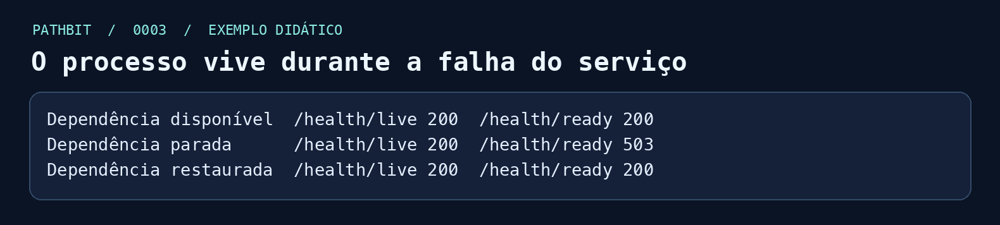

# Uma API pode estar viva e precisar sair do balanceamento

O serviço de estoque caiu. A API continua respondendo, mas cada pedido que depende dele falha. Se a sonda de liveness consulta o estoque, o orquestrador pode reiniciar réplicas que continuam saudáveis. Se a readiness só verifica o processo, o balanceador continua enviando tráfego que vai falhar.

No laboratório do **Pathbit Academy .NET**, a liveness do ASP.NET Core responde pelo processo e a readiness consulta uma dependência HTTP com timeout. A diferença fica visível quando você para o Nginx que simula essa dependência.

Na pasta do laboratório, suba os serviços e faça as duas consultas.

```bash
docker compose up -d --build --wait
docker compose stop dependency
curl -i -w '\n' http://localhost:19703/health/live
curl -i -w '\n' http://localhost:19703/health/ready
```

Na falha, `/health/live` devolve `200 Healthy` e `/health/ready` devolve `503 Unhealthy`. Execute `docker compose start dependency` e consulte a readiness de novo. Assim que a dependência aceitar conexões, ela volta a `200`.



No Kubernetes, as duas rotas podem ser ligadas a sondas separadas. A readiness define se o Pod pode receber tráfego. A liveness sinaliza se o contêiner precisa ser reiniciado. Antes de incluir uma integração na readiness, verifique se a falha dela realmente impede o Pod de atender ao tráfego esperado.

[Guia, código, manifesto Kubernetes e testes](https://github.com/pathbit/pathbit-academy-dotnet/tree/master/0003_liveness_readiness).

#DotNet #ASPNETCore #Kubernetes #PathbitAcademy
