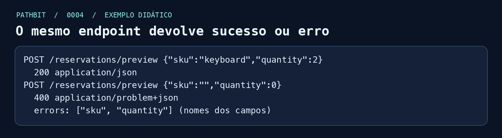
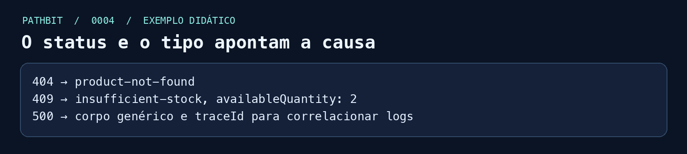

# Como dar ao cliente um erro HTTP que ele consiga tratar

Quem mantém o checkout precisa decidir o que fazer depois de uma reserva recusada. Se restam dois teclados, ofereça reduzir a quantidade. Se o produto saiu da vitrine, diga que ele está indisponível. Se o serviço de estoque caiu, dê ao cliente um código que o suporte possa localizar.

No laboratório seguinte, uma API ASP.NET Core implementa esses caminhos com Problem Details. Vamos fazer os pedidos que chegam a cada caso e acompanhar o resultado desde o status HTTP até as extensões JSON que a tela pode ler.

## Conheça o contrato no terminal

A API implementa uma prévia para o SKU `keyboard`. Ela mantém duas unidades disponíveis no código e aceita pedidos com quantidade de 1 a 5. O exemplo tem duas rotas. `POST /reservations/preview` percorre validação, busca e disponibilidade. `GET /operations/fail` simula uma falha interna para inspecionar o middleware.

| Entrada | Código HTTP | Informação que a tela usa |
| --- | --- | --- |
| `keyboard`, quantidade 2 | `200 OK` | `quantity` e `availableQuantity` para apresentar a prévia. |
| SKU vazio, quantidade 0 | `400 Bad Request` | `errors.sku` e `errors.quantity` para preencher a validação de campos. |
| `mouse`, quantidade 1 | `404 Not Found` | `type` indica produto ausente. |
| `keyboard`, quantidade 3 | `409 Conflict` | `availableQuantity: 2` sinaliza como corrigir a quantidade. |
| `GET /operations/fail` | `500 Internal Server Error` | `traceId` dá um identificador para discutir a falha com o suporte. |

Abra um terminal na pasta `0004_problem_details` com o SDK do .NET 10. Em um segundo terminal, faça os dois primeiros pedidos e leia o status, o `Content-Type` e o corpo.

```bash
dotnet run --project src/ProblemDetails.Api --no-launch-profile -- --urls http://127.0.0.1:19804
```

```bash
curl -si -w '\n' http://127.0.0.1:19804/reservations/preview \
  -H 'Content-Type: application/json' -d '{"sku":"keyboard","quantity":2}'
curl -si -w '\n' http://127.0.0.1:19804/reservations/preview \
  -H 'Content-Type: application/json' -d '{"sku":"","quantity":0}'
```

Os dois comandos enviam JSON. O sucesso devolve `application/json`. O erro retorna `application/problem+json` e inclui as duas chaves em `errors`. Na figura, o JSON de erro está resumido para deixar os campos de validação legíveis.



## Show me the code

O [Program.cs](../src/ProblemDetails.Api/Program.cs) reúne o pipeline e as rotas. O registro `AddProblemDetails` disponibiliza o serviço do ASP.NET Core para gerar as respostas de problema. A personalização adiciona `traceId` usando a atividade da requisição ou, quando ela não está disponível, `HttpContext.TraceIdentifier`. Os dois middlewares cobrem casos que ficam fora do retorno explícito da rota.

```csharp
builder.Services.AddProblemDetails(options =>
{
    options.CustomizeProblemDetails = context =>
    {
        // Estende o contrato com um identificador de correlação.
        context.ProblemDetails.Extensions["traceId"] =
            Activity.Current?.Id ?? context.HttpContext.TraceIdentifier;
    };
});

var app = builder.Build();
app.UseExceptionHandler();
app.UseStatusCodePages();
```

`UseExceptionHandler` trata exceções que podem ser convertidas antes do início da resposta. `UseStatusCodePages` complementa respostas de erro sem corpo, como o `404` de uma rota inexistente. Na rota da prévia, o código devolve explicitamente `Results.ValidationProblem` ou `Results.Problem`. Esse caminho permite definir tipos e campos de negócio em cada ramificação.

Quando a quantidade é inválida ou o SKU está em branco, a validação é agregada em um dicionário. A API sempre entrega as mensagens dos campos que falharam na mesma resposta.

```csharp
var errors = new Dictionary<string, string[]>();
if (string.IsNullOrWhiteSpace(request.Sku))
{
    errors["sku"] = ["Provide a product SKU."];
}
if (request.Quantity is < 1 or > 5)
{
    errors["quantity"] = ["Quantity must be between 1 and 5."];
}
if (errors.Count > 0)
{
    return Results.ValidationProblem(errors,
        type: "urn:pathbit:problem:invalid-reservation",
        title: "The reservation is invalid.");
}
```

O corpo `400` também tem um código estável em `type`. A tela pode usar esse identificador para apresentar a validação do formulário e percorrer `errors` para indicar os campos. Se alguém mudar a frase de `title` ou traduzir as mensagens, o comportamento continua alinhado ao mesmo tipo. Em um SDK cliente, compartilhe os identificadores de tipos como parte do contrato e reserve a frase para interface ou diagnóstico.

O próximo passo procura o SKU. Produto ausente devolve tipo `urn:pathbit:problem:product-not-found`. Se o produto existe, mas a quantidade ultrapassa o estoque, o corpo ganha a extensão `availableQuantity`.

```csharp
const int availableQuantity = 2;
if (request.Quantity > availableQuantity)
{
    return Results.Problem(
        statusCode: StatusCodes.Status409Conflict,
        type: "urn:pathbit:problem:insufficient-stock",
        title: "The requested quantity exceeds available stock.",
        extensions: new Dictionary<string, object?>
        {
            ["availableQuantity"] = availableQuantity
        });
}
```

O pedido de três unidades passa pela validação de formato. O conflito surge porque só existem duas naquele momento. Essa distinção é o que faz a tela ler `availableQuantity` e oferecer o ajuste certo. Já o pedido de seis unidades viola a regra de entrada e retorna `400`, mesmo quando o SKU existe.

## Rastreie o tipo e a origem da resposta

Execute os três comandos seguintes com a API ainda aberta. Compare o status com o campo `type` nos dois primeiros e observe `traceId` no último.

```bash
curl -si -w '\n' http://127.0.0.1:19804/reservations/preview \
  -H 'Content-Type: application/json' -d '{"sku":"mouse","quantity":1}'
curl -si -w '\n' http://127.0.0.1:19804/reservations/preview \
  -H 'Content-Type: application/json' -d '{"sku":"keyboard","quantity":3}'
curl -si -w '\n' http://127.0.0.1:19804/operations/fail
```

A primeira resposta é explícita da rota de prévia. A segunda também vem dessa rota, com um campo extra. A terceira vem do middleware porque a rota executada lança uma `InvalidOperationException`. A exceção pode aparecer no diagnóstico do servidor, mas a resposta expõe o problema HTTP genérico e o identificador de correlação. O contrato dá ao suporte um ponto de partida quando os logs da aplicação também registram o identificador da requisição. Para verificar esse caso no laboratório, mantenha o terminal da API aberto e observe a exceção registrada depois de chamar a rota de simulação.



A [RFC 9457](https://www.rfc-editor.org/rfc/rfc9457) define membros como `type`, `title`, `status`, `detail` e `instance`, além de extensões. Aqui, `traceId` e `availableQuantity` são extensões. A validação do ASP.NET Core acrescenta `errors`. Use o código da resposta HTTP para o tratamento geral, o tipo para o caso de negócio e valores estruturados para preencher a interface. Clientes genéricos devem tolerar extensões que ainda desconhecem.

## Teste os limites da resposta

Na raiz do repositório, rode `dotnet test tests/ProblemDetails.Tests`. Os testes exercitam o resultado válido, erros de campo, SKU ausente, estoque insuficiente, falha interna e respostas geradas pelo pipeline. O teste do erro interno também verifica se a mensagem da exceção ficou fora da resposta.

O cabeçalho `Accept` do cliente participa da seleção do writer do ASP.NET Core nas respostas de erro que passam pelo middleware. Se a integração recebe somente um status em uma falha da infraestrutura, confira se o cliente aceita uma representação JSON suportada e se outro middleware já iniciou a resposta. Para requests do laboratório, o `curl` padrão aceita qualquer tipo. [Tratamento de erros em APIs do ASP.NET Core](https://learn.microsoft.com/pt-br/aspnet/core/web-api/handle-errors?view=aspnetcore-10.0).

| Sintoma na integração | Verificação |
| --- | --- |
| A resposta é `400` e o erro é de leitura do JSON | Revise o corpo e `Content-Type`. O pipeline pode rejeitar a entrada antes de o handler validar os campos. |
| Uma rota inexistente devolve `404` | Compare o tipo de problema com `product-not-found` e confira o caminho chamado. |
| O cliente precisa explicar o `409` | Leia `availableQuantity` pelo tipo `insufficient-stock`. |
| O cliente recebeu um `500` | Inclua `traceId` no chamado de suporte e consulte o diagnóstico do servidor quando a correlação estiver configurada. |

O estoque fixo permite reproduzir cada resposta. Em um sistema que grava a reserva, a disponibilidade precisa ser validada de novo no momento da gravação, pois outro pedido pode consumir as unidades entre a prévia e a confirmação. Esse é justamente o tipo de situação em que o contrato de conflito continua útil.

[Guia do laboratório e código no GitHub](https://github.com/pathbit/pathbit-academy-dotnet/tree/master/0004_problem_details) · [Explore os testes](../../tests/ProblemDetails.Tests/)

Developed with ❤️ by [Pathbit](https://www.pathbit.com.br/)
