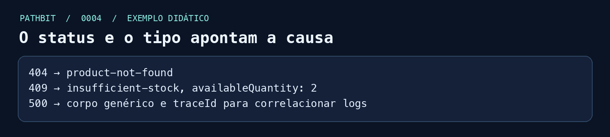

# Dê à tela uma resposta que ela consiga tratar

A vitrine tem dois teclados em estoque. Quando alguém pede três, o cliente precisa saber que pode reduzir a quantidade. Se o código do produto está vazio, precisa corrigir o formulário. Um texto genérico para todos esses erros deixa as duas situações indecifráveis para o código cliente.

No laboratório **Problem Details no ASP.NET Core**, a mesma rota de prévia devolve `400` com erros por campo, `404` para produto ausente e `409` com a quantidade disponível. Uma segunda rota simula uma exceção. O middleware devolve `500` com um identificador de correlação.

Com a API do laboratório em execução, faça a consulta que passa pela validação e esbarra no estoque.

```bash
curl -si http://127.0.0.1:19804/reservations/preview \
  -H 'Content-Type: application/json' -d '{"sku":"keyboard","quantity":3}'
```

O `Content-Type` da resposta é `application/problem+json`. O cliente recebe `409 Conflict`, o tipo estável `urn:pathbit:problem:insufficient-stock` e `availableQuantity: 2`. O tratamento pode exibir o ajuste adequado mesmo que o texto de `title` seja traduzido.



A prática vale para quem escreve e para quem consome APIs. Use o status HTTP para o tratamento geral, `type` para o caso de negócio e o restante do corpo para orientar a ação. Se o erro for inesperado, preserve a mensagem técnica no diagnóstico do servidor e entregue ao cliente o identificador usado no atendimento.

[Guia, comandos e testes do Pathbit Academy .NET](https://github.com/pathbit/pathbit-academy-dotnet/tree/master/0004_problem_details).

#DotNet #ASPNETCore #APIs #PathbitAcademy
