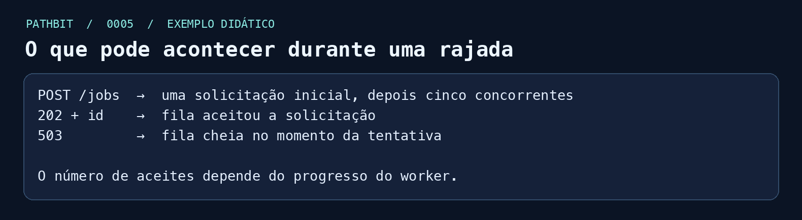
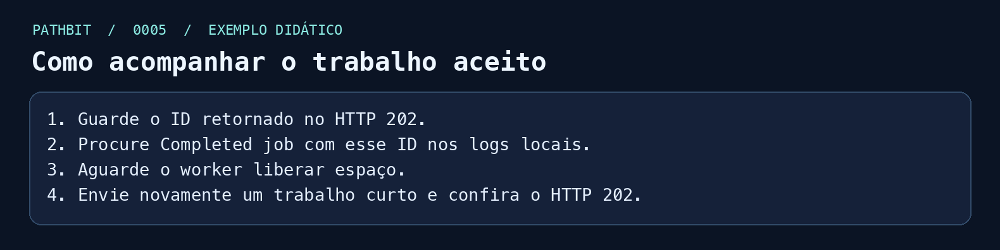

# Filas limitadas com Channels e BackgroundService no ASP.NET Core

Imagine uma tela que pede a exportação de um catálogo. Preparar cada arquivo toma alguns segundos. Em uma segunda-feira, seis pessoas clicam quase ao mesmo tempo. Se o servidor acumular trabalho sem limite, o pico vira atraso, uso de memória e notificações que chegam tarde. Se a aplicação aceitar apenas o que consegue colocar na fila, o cliente já sabe quais solicitações deve acompanhar e quais pode tentar novamente depois.

O laboratório reproduz esse comportamento com uma API .NET 10, uma fila em memória e um único consumidor. O trabalho é uma espera controlada que ajuda a enxergar o que costuma passar rápido demais no terminal.

## O recibo da API e a conclusão do trabalho

| Situação no `POST /jobs` | Resposta | Como interpretar |
| --- | --- | --- |
| `units` entre 1 e 5, com espaço na fila | `202 Accepted` com `id` | O processo admitiu a tarefa e devolveu um identificador. A execução vem depois. |
| `units` fora desse intervalo | `400 Bad Request` com `errors.units` | Corrija a entrada antes de reenviar. |
| Fila cheia | `503 Service Unavailable`, `Retry-After: 1` | O envio ficou de fora. Aguarde antes de decidir sobre uma nova tentativa. |

O corpo `{"units":5}` pede uma tarefa de 1.250 milissegundos, porque o processador usa 250 milissegundos por unidade. A fila tem duas posições de espera. Quando o worker já está ocupado, até três trabalhos podem estar relacionados ao lote, um em execução e dois armazenados. Retirar um item da fila libera a posição antes de terminar seu processamento. Essa diferença explica por que a quantidade de respostas `202` pode variar se todas as chamadas chegam juntas.

## Show me the code

A rota e o registro de dependências ficam no [Program.cs](../src/BoundedJobs.Api/Program.cs). A estrutura do canal fica em [JobQueue.cs](../src/BoundedJobs.Api/JobQueue.cs). O laço de consumo e o processador simulado ficam em [JobWorker.cs](../src/BoundedJobs.Api/JobWorker.cs).

O ASP.NET Core registra uma fila compartilhada no processo e inicia o consumidor junto com a aplicação. A mesma instância recebe chamadas simultâneas dos endpoints e alimenta o worker.

```csharp
builder.Services.AddSingleton(new JobQueue(capacity: 2));
builder.Services.AddSingleton<IJobProcessor, SimulatedJobProcessor>();
builder.Services.AddHostedService<JobWorker>();
```

O canal preserva a ordem em que os itens foram inseridos. Como várias requisições publicam ao mesmo tempo, essa ordem pode diferir da ordem em que o terminal exibe as respostas. O consumidor é único nesta configuração. O canal usa o modo `Wait`, e o método chamado pela API é `TryWrite`.

```csharp
private readonly Channel<Job> channel = Channel.CreateBounded<Job>(
    new BoundedChannelOptions(capacity)
    {
        SingleReader = true,
        SingleWriter = false,
        FullMode = BoundedChannelFullMode.Wait
    });

// Uma tentativa imediata preserva a decisão de rejeitar quando não há espaço.
public bool TryEnqueue(Job job) => channel.Writer.TryWrite(job);
```

Com esse modo, `WriteAsync` poderia aguardar espaço. `TryWrite` responde de imediato com `false` se o canal estiver cheio. A escolha dá à rota a oportunidade de informar saturação sem manter uma pilha de requisições esperando abertura de vaga. Modos que descartam itens atendem a outros requisitos, como atualização de telemetria, e mudariam o significado de uma tarefa aceita. [Canais assíncronos em .NET](https://learn.microsoft.com/pt-br/dotnet/core/extensions/channels).

No handler, a validação ocorre antes da criação do trabalho. O código a seguir é a etapa de admissão, após confirmar que `Units` está dentro do intervalo.

```csharp
var job = new Job(Guid.NewGuid(), request.Units);
if (!queue.TryEnqueue(job))
{
    context.Response.Headers.RetryAfter = "1";
    return Results.Problem(
        statusCode: StatusCodes.Status503ServiceUnavailable,
        type: "urn:pathbit:problem:job-queue-full",
        title: "The job queue is full.");
}

return Results.Accepted(value: new { id = job.Id });
```

`Retry-After: 1` é uma indicação de um segundo, sem reserva de posição para o próximo envio. A condição da fila depende do que o worker conclui e dos outros clientes que tentam publicar. Para novas tentativas automáticas em uma aplicação real, defina limite de tentativas e espaçamento. Defina também como identificar uma mesma solicitação quando o cliente perdeu a resposta a uma primeira tentativa válida. Nesta API, cada novo envio admitido cria um GUID próprio, inclusive com o mesmo corpo.

O worker faz `await` de um trabalho por vez. Uma exceção no processador é registrada com o identificador e a iteração seguinte pode continuar. O token do host chega ao processador e permite interromper a espera quando a aplicação está parando.

```csharp
await foreach (var job in queue.ReadAllAsync(stoppingToken))
{
    try
    {
        await processor.ProcessAsync(job, stoppingToken);
    }
    catch (OperationCanceledException) when (stoppingToken.IsCancellationRequested)
    {
        return;
    }
    catch (Exception error)
    {
        logger.LogError(error, "Job {JobId} failed.", job.Id);
    }
}
```

## O que acontece em uma rajada de chamadas

Na pasta `0005_filas_limitadas`, inicie a API e deixe o terminal aberto para ler os logs.

```bash
dotnet run --project src/BoundedJobs.Api --no-launch-profile -- --urls http://127.0.0.1:19805
```

Em um segundo terminal Bash, envie uma tarefa inicial, dê um intervalo curto para o worker ler e dispare outras cinco em paralelo. O intervalo ajuda a observar uma tarefa ativa antes de preencher as duas posições de espera. Ele depende do agendamento do processo, por isso a distribuição de respostas pode mudar em uma máquina ocupada.

```bash
curl -sS -w ' %{http_code}\n' http://127.0.0.1:19805/jobs \
  -H 'Content-Type: application/json' -d '{"units":5}'
sleep 0.15
for ((request=0; request<5; request++)); do
  (
    response=$(curl -sS -w ' %{http_code}' http://127.0.0.1:19805/jobs \
      -H 'Content-Type: application/json' -d '{"units":5}')
    printf '%s\n' "$response"
  ) &
done
wait
```

No ensaio registrado, três chamadas receberam um identificador e `202`. As outras três receberam `503` com o tipo de fila cheia. A imagem mostra os IDs e os campos do erro usados para identificar o cenário. Para ler os cabeçalhos de um caso individual, use `curl -i` em uma tentativa extra enquanto a fila estiver cheia.



Em seguida, procure os mesmos GUIDs pela mensagem `Completed job` no terminal da API. Aguarde o processamento e faça uma nova chamada com `units: 1`. Ela volta a receber `202` quando há vaga. A captura liga o recibo HTTP aos logs de conclusão e mostra o novo envio aceito.



## Teste sem depender do tempo da máquina

Na raiz do repositório, rode `dotnet test tests/BoundedJobs.Tests`. O [teste de contrato](../../tests/BoundedJobs.Tests/JobContracts.cs) substitui o processador simulado por um controlado pelo teste. A primeira tarefa sinaliza quando entrou no worker e fica bloqueada. Em seguida, duas chamadas preenchem o canal e uma quarta recebe `503`. O teste libera o processamento e confirma a ordem dos IDs admitidos. Assim a verificação de capacidade tem a condição inicial que a rajada do terminal só tenta aproximar.

A suíte também injeta falha em um trabalho e confirma que o seguinte pode prosseguir. Em outro caso, a quantidade inválida recebe `400`. Para uma fila que sustenta trabalho de clientes, são três verificações úteis e independentes, capacidade, continuidade após erro e validação antes da admissão.

| O que você vê | O que verificar |
| --- | --- |
| Uma tarefa recebeu `202` e ainda está sem log de conclusão | Compare o GUID com o log e considere o tempo das tarefas anteriores. |
| Várias tarefas recebem `503` | Confira se o worker continua consumindo e se o tempo por tarefa explica a saturação. |
| O lote mostrou dois aceitos em vez de três | O canal pode ter recebido os primeiros itens antes que a tarefa inicial entrasse em execução. |
| Um trabalho falhou no processador | Use o GUID para localizar o erro. Decida se repeti-lo é seguro antes de reenviar. |

## O que fica a cargo de uma fila de produção

O canal e os trabalhos pendentes vivem na memória do processo. Se a API for reiniciada, a fila desaparece. Cada réplica também tem a própria fila e seu próprio worker. Para uma exportação que precisa sobreviver a reinícios, use armazenamento durável e associe o identificador a um estado que o cliente possa consultar. Planeje como evitar efeitos duplicados quando um trabalho for retomado ou reenviado.

Use o exemplo para decidir onde colocar o limite e como comunicar a saturação. O cenário mostra a fronteira entre admitir uma solicitação pelo HTTP e comprovar que o worker terminou.

[Comece pelo guia do laboratório](../README.md) · [Explore os testes](../../tests/BoundedJobs.Tests/)

Developed with ❤️ by [Pathbit](https://www.pathbit.com.br/)
