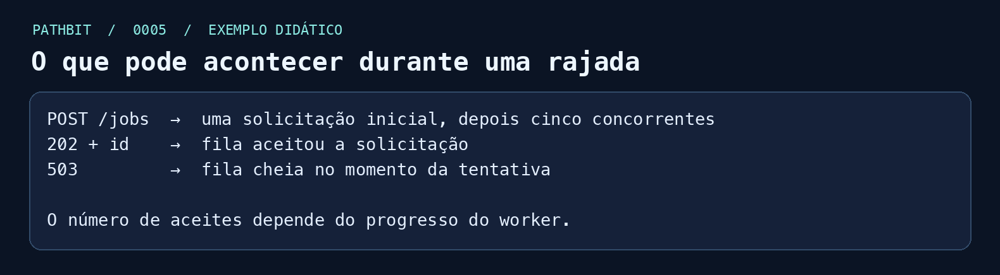

# O que seu endpoint faz quando a fila enche?

Seis pedidos de exportação chegam quase juntos. Cada exportação leva tempo e o servidor só tem um worker. Quanto trabalho o endpoint consegue aceitar antes de precisar pedir ao cliente que tente depois?

No laboratório do **Pathbit Academy .NET**, uma Minimal API usa um `Channel<T>` de duas posições e um `BackgroundService`. O worker retira um trabalho de cada vez. Enquanto uma tarefa está em execução, outras duas podem esperar na fila.

Com a API em execução, envie um trabalho com cinco unidades para que ele dure 1,25 segundo.

```bash
curl -si http://127.0.0.1:19805/jobs \
  -H 'Content-Type: application/json' -d '{"units":5}'
```

O `202 Accepted` vem com um GUID. Esse recibo indica que o trabalho entrou no processo. Para comprovar a conclusão, procure o mesmo ID em `Completed job` no log do worker. Se a fila estiver cheia, a tentativa recebe `503` com `Retry-After: 1` e pode ser refeita quando houver vaga.

A figura mostra como interpretar uma tarefa inicial seguida de cinco envios concorrentes. A divisão entre `202` e `503` depende de quando o worker consegue retirar o primeiro item. Os testes reproduzem essa situação com o processador controlado.



A fila é local ao processo. Trabalhos que precisam sobreviver a uma reinicialização exigem armazenamento durável, e cada estado precisa acompanhar o identificador devolvido para o cliente.

[Guia com o script da rajada e os testes de capacidade](https://github.com/pathbit/pathbit-academy-dotnet/tree/master/0005_filas_limitadas).

#DotNet #ASPNETCore #Channels #PathbitAcademy
