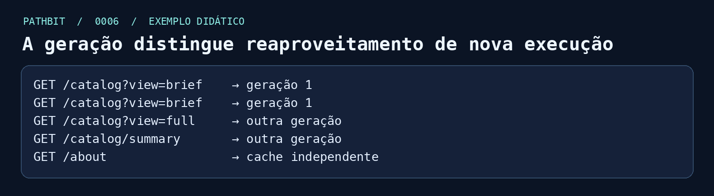
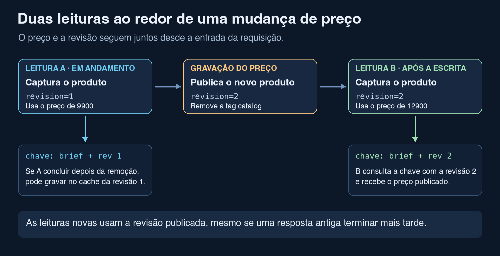
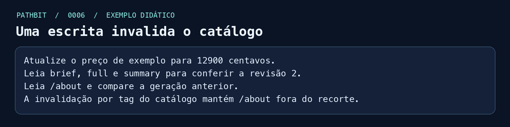

# Output Cache no ASP.NET Core com variação e invalidação

Uma página de produto pede nome, descrição e preço. Uma vitrine usa uma versão compacta dos mesmos dados. As duas consultas ganham velocidade quando o servidor pode reutilizar respostas, mas aparece um problema assim que uma promoção começa. A tela completa recebe o preço atual e a vitrine continua oferecendo o valor anterior por mais dois minutos.

Vamos usar um catálogo mínimo para observar três decisões. O que identifica uma resposta, quais respostas devem sair juntas quando o preço muda e como uma leitura em andamento usa a versão do produto que recebeu.

## Veja o que muda em cada chamada

A API mantém um teclado em memória, inicialmente com preço de `9900` centavos e revisão `1`. Dois números aparecem nas leituras. `revision` muda quando o preço é gravado. `generation` é um contador global que só avança quando um dos handlers de leitura é executado. Se você repetir uma consulta e receber a mesma geração, o middleware reaproveitou o corpo já armazenado.

| Requisição | O que ela demonstra |
| --- | --- |
| `GET /catalog?view=brief` | A variante compacta pode reaproveitar a própria resposta. |
| `GET /catalog?view=full` | A variante completa tem uma entrada própria e inclui a descrição. |
| `GET /catalog/summary` | A rota de resumo compartilha a tag do catálogo e tem seu próprio caminho. |
| `GET /about` | O cache independente da página institucional usa outra tag. |
| `POST /catalog/price` | A gravação atualiza o preço, aumenta a revisão e invalida o grupo do catálogo. |

Abra dois terminais na pasta `0006_output_cache`. Inicie um processo novo para reproduzir o estado inicial do exemplo.

```bash
dotnet run --project src/CatalogCache.Api --no-launch-profile -- --urls http://127.0.0.1:19806
```

```bash
curl -sS -w '\n' 'http://127.0.0.1:19806/catalog?view=brief'
curl -sS -w '\n' 'http://127.0.0.1:19806/catalog?view=brief'
curl -sS -w '\n' 'http://127.0.0.1:19806/catalog?view=full'
curl -sS -w '\n' 'http://127.0.0.1:19806/catalog/summary'
curl -sS -w '\n' 'http://127.0.0.1:19806/about'
```

Na execução abaixo, as duas leituras compactas devolvem `generation: 1`. A variante completa, o resumo e a rota institucional executam seus handlers e avançam o contador. Todos os dados do catálogo ainda têm revisão `1`. Se outra pessoa já usou o processo, compare a igualdade das duas gerações e a mudança entre variantes usando os números que você recebeu.



## Show me the code

A política e os handlers ficam no [Program.cs](../src/CatalogCache.Api/Program.cs). A atualização do estado do produto e o contador de gerações ficam em [Catalog.cs](../src/CatalogCache.Api/Catalog.cs).

A política `catalog` associa prazo de validade, grupo de invalidação e fatores de variação. A chave do middleware considera o caminho e outros componentes da solicitação. Os dois métodos de variação adicionam a forma pedida em `view` e a revisão em uso.

```csharp
options.AddPolicy(catalogTag, policy => policy
    .Expire(TimeSpan.FromMinutes(2))
    .Tag(catalogTag)
    .SetVaryByQuery("view")
    .VaryByValue(context => new KeyValuePair<string, string>(
        "revision",
        context.Features.Get<Product>()!.Revision.ToString(CultureInfo.InvariantCulture))));
```

`SetVaryByQuery("view")` permite que brief e full tenham corpos diferentes sem substituir a entrada uma da outra. `Tag("catalog")` agrupa essas entradas e as de `/catalog/summary` para a escrita poder removê-las juntas. O prazo de dois minutos limita a permanência de uma entrada no cache, inclusive quando ela deixa de ser usada antes de expirar. A API ativa a política nos endpoints com `.CacheOutput(catalogTag)`.

Antes da consulta ao cache, um middleware guarda o registro imutável `Product` em `HttpContext.Features`. Assim a política lê a revisão da mesma instância que o handler usará para ler o preço.

```csharp
app.Use((context, next) =>
{
    // A política e o eventual handler usam este registro durante a requisição.
    context.Features.Set(catalog.CurrentProduct);
    return next(context);
});
app.UseOutputCache();
```

O snapshot é importante quando duas requisições chegam juntas. Imagine que a requisição A pega o produto na revisão 1. Logo depois, uma escrita publica a revisão 2. A requisição A ainda pode concluir usando o estado que recebeu e até preencher uma entrada com a chave da revisão 1. Uma requisição B que começa depois da gravação pega a revisão 2 em `Features` e procura a chave da revisão 2. Como preço e revisão vêm juntos, A também evita produzir um corpo com preço novo associado a uma chave de revisão antiga.



A gravação em `Catalog.ChangePrice` usa um lock para avançar a revisão e publicar um novo registro via `Volatile.Write`. A leitura via `Volatile.Read` vê o estado como uma referência única. Depois da atualização, o handler pede ao cache que remova a tag do catálogo. O trecho abaixo roda após validar o intervalo de preço.

```csharp
var product = catalog.ChangePrice(request.PriceInCents);
await cache.EvictByTagAsync(catalogTag, CancellationToken.None);
return Results.Ok(product);
```

A revisão faz as novas leituras escolherem as chaves atualizadas. A remoção pela tag limpa as entradas daquele grupo que já existem quando a operação acontece. Com os dois mecanismos, o projeto reduz resíduos no cache e trata o caso de uma requisição antiga concluir durante a transição. Uma resposta antiga criada depois da remoção pode seguir armazenada sob a revisão antiga até o seu próprio prazo.

## Altere o preço e leia as quatro rotas de novo

Com o processo do primeiro experimento ainda em execução, altere o preço para `12900` centavos.

```bash
curl -sS -w '\n' http://127.0.0.1:19806/catalog/price \
  -H 'Content-Type: application/json' -d '{"priceInCents":12900}'
curl -sS -w '\n' 'http://127.0.0.1:19806/catalog?view=brief'
curl -sS -w '\n' 'http://127.0.0.1:19806/catalog?view=full'
curl -sS -w '\n' 'http://127.0.0.1:19806/catalog/summary'
curl -sS -w '\n' 'http://127.0.0.1:19806/about'
```

Nas três respostas do catálogo, procure preço `12900`, revisão `2` e uma geração nova. Em `/about`, a geração continua igual à primeira leitura se a entrada ainda estiver no prazo. O preço e a revisão podem variar se você repetir a gravação várias vezes. Repita o `GET` da visão completa para verificar que a nova resposta agora também é reaproveitada.



## Verifique que cada mecanismo faz a parte esperada

Na raiz do repositório, rode `dotnet test tests/CatalogCache.Tests`. O [arquivo de contratos](../../tests/CatalogCache.Tests/CacheContracts.cs) exercita as variantes, a mudança de preço, a limpeza por tag, a revisão e a validação.

O teste de tag chama `EvictByTagAsync` diretamente, sem gravar um novo preço, e confirma que catálogo e resumo voltam a executar seus handlers com a mesma revisão. O teste da revisão altera o catálogo sem executar a invalidação e verifica se a nova consulta recebeu o estado atualizado. Esses dois experimentos mostram por observações diferentes a contribuição de cada mecanismo. Um preço inválido devolve `400` e a leitura anterior preserva a geração.

| Comportamento observado | Onde investigar |
| --- | --- |
| As leituras parecem gerar respostas novas a cada tentativa | Verifique se a consulta e a revisão coincidem e se a política permite armazenar a resposta. |
| Um cliente viu um valor antigo durante a gravação | Confira quando a requisição começou e qual revisão aparece junto do preço. |
| `/about` mudou de geração | Verifique se expirou, se o processo reiniciou ou se aquela entrada ainda não tinha sido criada. |
| Réplicas apresentam resultados diferentes | Identifique onde cada processo lê a revisão e em qual armazenamento guarda as respostas. |

## Onde aplicar o exemplo

O laboratório usa Output Cache no servidor para respostas públicas. Antes de aplicar a política a uma rota, confira se o corpo é o mesmo para as pessoas que vão compartilhar a chave. O ASP.NET Core restringe por padrão o cache de saída a respostas elegíveis, entre elas GET ou HEAD bem-sucedidos sem autenticação nem emissão de cookies. Cache de saída e cache de navegador têm políticas próprias. [Output Cache no ASP.NET Core](https://learn.microsoft.com/pt-br/aspnet/core/performance/caching/output?view=aspnetcore-10.0).

Neste processo, o catálogo e o cache vivem em memória. Em um serviço com várias réplicas, defina de onde elas obtêm o estado e a revisão e como compartilham a invalidação. Compartilhar só a infraestrutura de cache ainda deixaria réplicas calculando chaves divergentes se cada uma mantivesse um preço local diferente.

[Comece pelo guia do laboratório](../README.md) · [Explore os testes](../../tests/CatalogCache.Tests/)

Developed with ❤️ by [Pathbit](https://www.pathbit.com.br/)
