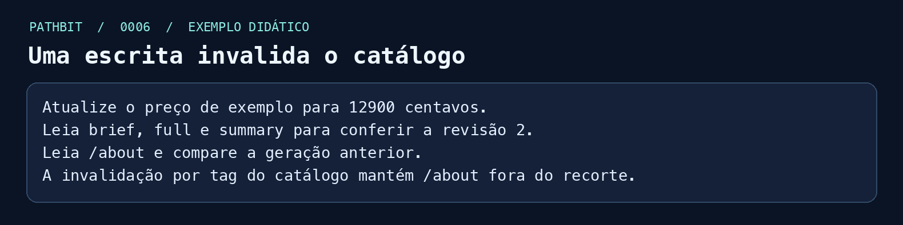

# Quando o preço muda, quais respostas precisam sair do cache?

Você aplica um preço promocional no teclado. A página completa mostra o novo valor, enquanto o resumo da vitrine ainda exibe o preço anterior. A resposta de cada rota foi armazenada em uma entrada distinta.

No laboratório de **Output Cache do Pathbit Academy .NET**, o ASP.NET Core usa `view` e a revisão do produto para distinguir respostas. As variantes compacta e completa e a rota de resumo compartilham a tag `catalog`. Assim a escrita pode limpar o grupo. Uma rota de apresentação usa uma tag própria.

Com a API aberta, aqueça as rotas de catálogo e a rota `/about`. Depois, altere o preço e compare a revisão e a geração nas consultas.

```bash
curl -sS http://127.0.0.1:19806/catalog/price \
  -H 'Content-Type: application/json' -d '{"priceInCents":12900}'
curl -sS 'http://127.0.0.1:19806/catalog?view=brief'
```

O contador de geração avança quando o handler roda. Em um processo recém-aberto, a gravação muda a revisão de 1 para 2 e as leituras do catálogo ganham novas gerações. `/about` preserva a geração que estava em cache porque o seu grupo é independente.



A revisão também ajuda quando uma leitura antiga termina depois da remoção por tag. Ela pode gravar na chave com a revisão anterior. As próximas consultas usam a revisão nova e ficam fora daquela entrada.

[Guia, código da política e testes de variação e invalidação](https://github.com/pathbit/pathbit-academy-dotnet/tree/master/0006_output_cache).

#DotNet #ASPNETCore #Caching #PathbitAcademy
